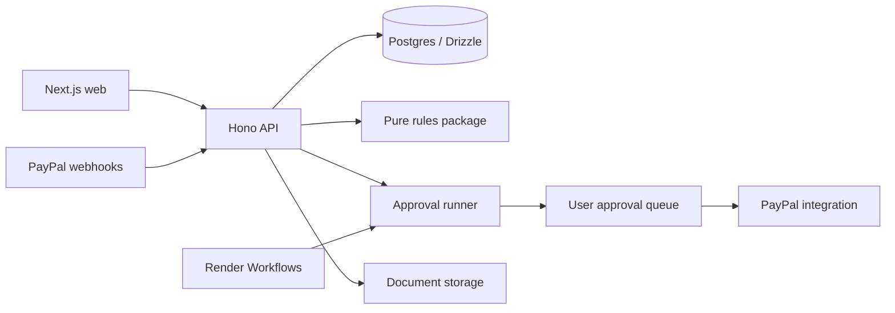

# Architecture

The [product plan](PLAN.md) owns scope. Through Phase 3, Niryat implements email sign-in, profiles, cited health and export checks, clients, invoice PDFs, approval-gated sandbox invoicing, payment webhooks and reconciliation. The monthly-close workflow remains a stub; FIRA handling and AI execution are future phases.

## Components and flow

Verified PayPal events and transaction backfill populate the payment ledger. Issuing an invoice creates a PDF and a persistent action proposal; user approval permits PayPal execution. Future phases add FIRA extraction and matching, further compliance records and AI-proposed actions.

## Three-layer PayPal integration

| Layer                 | Owner                    | Responsibility                                       |
| --------------------- | ------------------------ | ---------------------------------------------------- |
| TypeScript Server SDK | packages/paypal/src/sdk  | Transaction search and refunds                       |
| PayPal Agent Toolkit  | packages/agent           | AI-facing PayPal actions through approval            |
| Typed REST client     | packages/paypal/src/rest | Invoicing v2 and Disputes v1, absent from Server SDK |

Webhook verification belongs to packages/paypal/src/webhooks and uses PayPal's verify API before any payment write. The installed Server SDK supplies capture reads and paginated transaction search through the ledger adapter. The sandbox REST client implements Invoicing with cached OAuth tokens, POST request IDs, response validation and retries. Refunds, Disputes operations and the Agent Toolkit remain deferred. See [PayPal guide](paypal.md).

## Approval and trust boundaries

Every user-initiated PayPal action requires explicit user approval. Issuing saves an immutable invoice/PDF and a proposed `agent_actions` payload without calling PayPal. The authenticated approve route checks ownership, then packages/agent's runner atomically claims a proposed or failed action as approved before executing its validated payload. Success finishes as done; errors finish as failed; rejection is final. Execution stores created PayPal IDs before sending or activating, and uses stable `<actionId>-<step>` request IDs for retries. Webhook verification and reconciliation are deterministic ingestion paths. Future agent-initiated calls use this same approval boundary; approval cannot be supplied by the model itself.

Zod validates external inputs and environment values. Rules are pure, versioned and cited; AI handles extraction, classification, matching and explanations, never legal or numeric truth. A rule whose YAML `logic` names a function is implemented in packages/rules; the rest are metadata only.

## Storage and runtime

apps/web uses Next.js App Router; apps/api uses Hono on Node 24. Shared packages export TypeScript source; their build step checks types, while Next produces a production build. apps/worker registers monthlyClose with Render's TypeScript SDK and returns not_implemented.

The web app proxies /api/* to the API through Next rewrites, so the session cookie stays same-origin.

Drizzle declares the twelve tables from PLAN section 13. Migrations live in packages/db/drizzle; createDb in packages/db/src/client.ts; GSTIN, PAN fragments and profile/client addresses are AES-GCM encrypted. No seed data yet. Invoice PDFs use private S3-compatible storage (local SeaweedFS in development). The API streams them through `/files/:token`, exposed by the web proxy as `/api/files/:token`; the PDF link is included in the PayPal invoice note. FIRA storage remains spec 07. See [local storage](local-storage.md) for setup and its development-only encryption limitation.

The Render Blueprint configures two web services, one workflow service, paid Postgres and a `niryat-sync` cron. The cron runs `sync:payments` over the last seven days at `30 20 * * *` UTC (02:00 IST); transaction search supplements webhooks and deduplicates on PayPal transaction IDs. Local reconciliation is user-verified; hosted deployment remains Phase 7. Workflows currently need a separate trigger for monthly scheduling; add it with [spec 08](specs/08-monthly-close.md), following [Render's scheduling guidance](https://render.com/docs/workflows). AG Studio and Bryntum remain deferred dependencies.
