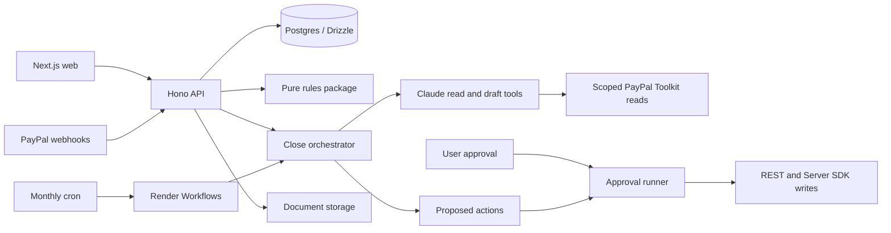

# Architecture

The [product plan](PLAN.md) owns scope. Through Phase 5, Niryat implements email/password and PayPal sign-in, profiles, cited health/export checks, clients, invoice PDFs, approved sandbox invoicing/refunds/reminders, payment/refund ingestion, dispute polling, tasks, deterministic FIRA matching, source-quoted invoice extraction and Claude-assisted monthly close. Login acceptance is user-confirmed (2026-10-30), and Phase 5's manual/CLI flows are user-confirmed (2026-10-31). FIRA parsing remains verified only against a synthetic fixture. Hosted deployment and reliability checks remain Phase 7; see [verification](verification.md).

## Components and flow

Verified PayPal events and transaction backfill populate the ledger. Issuing an invoice creates a PDF and persistent proposal; user approval permits PayPal execution. Refund/dispute records feed cited messages and tasks. Uploaded FIRA PDFs are parsed and matched without AI; uncertain matches require user confirmation. Claude investigates and drafts; reports and sponsor UI remain future phases.

## Sign-in

Sign-in uses the existing sandbox app's authorization-code flow and server-side userinfo. A unique payer ID identifies returning users; an email collision does not link accounts, and no login token is retained. PayPal-only users have a nullable password hash (migration `0004_closed_mantis`). Both sign-in methods use the existing signed session cookie. The app owner uses email sign-in; seller operations still use that app owner's credentials. In local development the web proxy targets `API_URL=http://localhost:3001`, while browser links and the callback use `PUBLIC_APP_URL`.

## Three-layer PayPal integration

| Layer                 | Owner                    | Responsibility                                       |
| --------------------- | ------------------------ | ---------------------------------------------------- |
| TypeScript Server SDK | packages/paypal/src/sdk  | Transaction search and refunds                       |
| PayPal Agent Toolkit  | packages/agent           | Five projected, owner-scoped read-only agent tools   |
| Typed REST client     | packages/paypal/src/rest | Invoicing v2 and Disputes v1, absent from Server SDK |

Webhook verification belongs to packages/paypal/src/webhooks and uses PayPal's verify API before ingestion. The Server SDK supplies capture/refund reads, approved refunds and paginated transaction search through the ledger adapter. The REST client implements Invoicing and Disputes with cached OAuth tokens, POST request IDs, validation and action-specific retries. Reminders explicitly disable retries because endpoint idempotency is unverified ([ADR 0004](decisions/0004-reminders-via-rest.md)). Toolkit reads are implemented; Toolkit writes remain deferred. See [PayPal guide](paypal.md).

## Corrections and proof

Refund notifications, approved refunds and reconciliation converge on `recordRefundById`: read the completed refund, ensure its capture is recorded, link it to an invoice and persist a positive refund row with PayPal's fee/net fields. Invoice-refund notifications first read the current invoice's PayPal refund IDs through REST. An unlinked refund stays in the ledger without a user task. One SQL roll-up computes invoice payment/refund status; `creditNoteFor` and `realisationFor` supply the compliance view. A lost dispute alone never subtracts money.

Dispute webhooks and the sync's seven-day Disputes API poll converge on `recordDispute`. It ensures the first disputed capture, preserves invoice links and ignores stale PayPal updates. Only linked disputes create user tasks. `ensureTask` deduplicates refund/opened-dispute/lost-dispute tasks by stable keys; only the user marks them done. Invoice and task reads are owner-scoped. Local `pnpm dev` does not schedule reconciliation: run `sync:payments` manually when a webhook is missed.

FIRA upload requires a session, `application/pdf`, explicit storage consent and at most 2 MB. The API checks PDF bytes, extracts text with `unpdf`, validates the deterministic parser's output and rejects unreadable documents before storage. SHA-256 detects duplicates per user. Matching accepts an exact reference/amount/currency match at full confidence; amount/date suggestions wait for confirmation. A payment is reserved only once. The database saves the document, source lines and matches atomically; invoice status is matched, pending or missing based on payment matches and covered months. See [spec 07](specs/07-fira-matching.md) for the synthetic-layout limitation and demo seed.

## Approval and trust boundaries

Every PayPal write requires explicit user approval. Issuing saves an immutable invoice/PDF and proposed `agent_actions` payload without calling PayPal. The authenticated approve route checks ownership, then the runner atomically claims a proposed or failed invoice/refund action before execution. Created PayPal IDs survive retries with stable `<actionId>-<step>` request IDs. Reminders can claim only `proposed`, permit one attempt and cannot resend after failure or interruption; unknown outcomes also cannot be rejected as unsent. Success finishes as done; rejection is final. Webhook verification/reconciliation are deterministic ingestion paths. The in-product agent may use only scoped, logged Toolkit reads without approval ([ADR 0005](decisions/0005-agent-boundary.md)); it has no write or approval tools.

Zod validates external inputs and environment values. Rules are pure, versioned and cited; implemented AI handles extraction, investigation and explanations, never legal or numeric truth. FIRA matching remains deterministic. A YAML `logic` function names implemented rules logic; three rules remain `TODO` for Phase 6.

## Agents, close and extraction

The close orchestrator first syncs payments/disputes, loads owner-scoped invoice views, ensures overdue tasks, builds SQL month totals and FIRA status, and selects rule-due reminder candidates. Claude then investigates with Niryat reads and five Toolkit wrappers (`get_invoice`, `list_invoices`, `get_dispute`, `list_disputes`, `list_transactions`) before drafting advice, tasks and a focus summary. Code validates known entities, digit-free narrative and proposal stages, then persists immutable proposed actions and deduplicated tasks. Every due candidate gets a standard-reminder proposal even when Claude is missing, fails, exhausts its budget or skips a candidate; those proposals carry `agent: null`. Rejected stage keys remain reserved. An older pending stage is not replaced when the next stage arrives.

`agent_runs` stores user, kind, trigger, month, `asOf`, status, structured summary and estimated AI cost. One running row per user/kind is allowed; a later start can fail a row stale after 15 minutes. `agent_tool_calls` stores sequential system/agent inputs, outputs and outcomes. Toolkit response logs contain item/byte summaries, not raw PayPal bodies. Projections drop PayPal personal fields and filter known ownership before Claude sees data. Model text is advisory; deterministic figures and citations remain available after AI failure.

The SDK has no built-in tools, filesystem settings or persisted sessions, and sees only Niryat's supplied MCP server. Its minimal subprocess environment excludes PayPal, storage and database credentials. Bare `allowedTools` can bypass the redundant `canUseTool` callback; validation/dispatch wrappers and absence of execution tools enforce the actual boundary. A deployment-wide monthly cost estimate, turn bounds and per-run caps constrain AI use. Concurrent/in-flight costs can overshoot the monthly cap by a run; this is not a provider billing guarantee.

`POST /close` starts a current-IST-month manual run, returns HTTP 202 and runs work inside the API process. The page refreshes every three seconds while running; concurrent starts return 409. `close:run` and the Workflows task run scheduled closes over users sequentially, defaulting to the previous IST month. The CLI accepts `--month` and `--as-of` directly, without an extra `--` separator. Demo `asOf` affects rule dates and real dedupe keys; it does not rewind PayPal data or the run timestamp. The nightly sync runs only the reminder agent when new candidates exist. Manual API work is not durable across process restarts; Phase 7 must verify recovery without replaying claimed reminders.

Extraction sends the brief once to a separate Claude draft tool. Code checks each field against its verbatim quote, including full amount/email tokens and negative signs, before showing it. Logs retain found field names and run/cost metadata, not the brief. `Use these values` only prefills forms; existing-client matching is explicit, export answers and SAC stay with the user, and Discard saves no client, invoice or action. Form submission issues the invoice, and user approval separately permits its PayPal send. Missing/budget-exhausted AI leaves manual forms available.

## Storage and runtime

apps/web uses Next.js App Router; apps/api uses Hono on Node 24. Shared packages export TypeScript source; their build step checks types, while Next produces production assets. apps/worker registers the `monthlyClose` task with Render's SDK and a 900-second timeout, validates input and calls the shared close composition root.

The web app proxies /api/* to the API through Next rewrites, so the session cookie stays same-origin.

Drizzle declares the fourteen tables from PLAN section 13, including runs and tool calls (migration `0005`). Migrations live in packages/db/drizzle; createDb in packages/db/src/client.ts; GSTIN, PAN fragments and profile/client addresses are AES-GCM encrypted. Invoice PDFs use private S3-compatible storage (local SeaweedFS in development). The API streams them through `/files/:token`, exposed by the web proxy as `/api/files/:token`; the PDF link is included in the PayPal invoice note. FIRA PDFs use the same private store under `fira/<userId>/<documentId>.pdf`, with no public token or link; source text is stored in plaintext in Postgres. `seed:fira-demo` creates a demo ledger only for an account with no invoices. See [local storage](local-storage.md) for setup and its development-only encryption limitation.

The Render Blueprint defines two web services, a workflow service, paid Postgres and two crons. `niryat-sync` runs the seven-day reconciliation at `30 20 * * *` UTC (02:00 IST). `niryat-monthly-close` runs at `30 1 1 * *` UTC (07:00 IST on the first), dispatching `niryat-worker/monthlyClose` with the SDK; the task itself has no schedule. Local P5-13 acceptance used the API CLI fallback, not Workflows dev. Hosted task registration, both crons, webhook delivery, sync freshness and restart recovery remain [Phase 7 checks](build-flow.md#phase-7-judge-mode-hosting-and-freeze-nov-58). AG Studio and Bryntum remain deferred dependencies.
