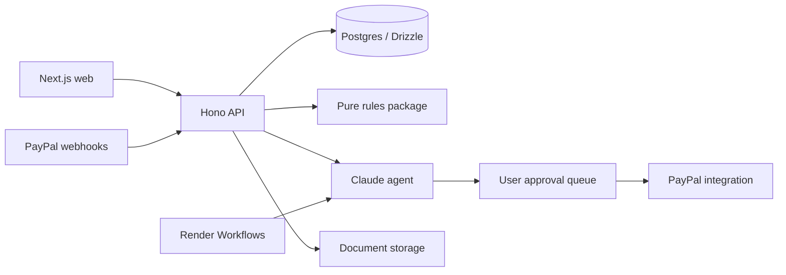

# Architecture

The [product plan](PLAN.md) owns scope. This repository implements only a scaffold: a placeholder web page, API health endpoint, workflow stub, package boundaries and database table definitions.

## Components and flow

Future flow: verified PayPal events and transaction backfill populate the ledger; user-confirmed FIRA extraction links remittances; rules derive compliance records; the agent proposes actions; user approval permits execution and an audit record. None of this flow executes in the skeleton.

## Three-layer PayPal integration

| Layer                 | Owner                    | Responsibility                                       |
| --------------------- | ------------------------ | ---------------------------------------------------- |
| TypeScript Server SDK | packages/paypal/src/sdk  | Transaction search and refunds                       |
| PayPal Agent Toolkit  | packages/agent           | AI-facing PayPal actions through approval            |
| Typed REST client     | packages/paypal/src/rest | Invoicing v2 and Disputes v1, absent from Server SDK |

Webhook verification belongs to packages/paypal/src/webhooks and currently throws. SDK adapters are deferred, so no payment SDKs are installed. See [PayPal guide](paypal.md).

## Approval and trust boundaries

Every PayPal action requires explicit user approval. The queue contract is in packages/agent; persistence and execution remain unimplemented. Future execution must check owner, exact approved payload and current status atomically, handle retries without duplicate actions, and log each tool call. Approval cannot be supplied by the model itself.

Zod validates external inputs and environment values. Rules are pure, versioned and cited; AI handles extraction, classification, matching and explanations, never legal or numeric truth. All rule metadata is inert until primary-source and CA review.

## Storage and runtime

apps/web uses Next.js App Router; apps/api uses Hono on Node 24. Shared packages export TypeScript source; their build step checks types, while Next produces a production build. apps/worker registers monthlyClose with Render's TypeScript SDK and returns not_implemented.

Drizzle declares the twelve tables from PLAN section 13. Migrations live in packages/db/drizzle; createDb in packages/db/src/client.ts; GSTIN and PAN fragments are AES-GCM encrypted. No seed data yet. PDFs and FIRAs will use external file storage.

Render hosting uses two web services, one workflow service and paid Postgres. Workflows currently need a separate trigger for monthly scheduling; add it with [spec 08](specs/08-monthly-close.md), following [Render's scheduling guidance](https://render.com/docs/workflows). AG Studio and Bryntum remain deferred dependencies.
