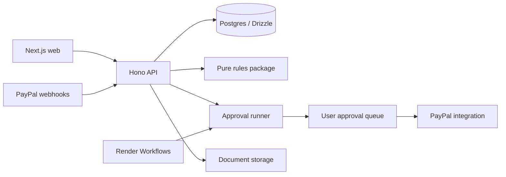

# Architecture

The [product plan](PLAN.md) owns scope. Through Phase 4 and the completed spec 01 login follow-up, Niryat implements email/password and PayPal sign-in, profiles, cited health and export checks, clients, invoice PDFs, approval-gated sandbox invoicing and refunds, payment/refund ingestion, dispute polling, tasks and deterministic FIRA matching. All login-plan browser checks are user-confirmed (2026-10-30); see [V02](verification.md#v02-identity). FIRA parsing is verified only against a synthetic fixture; real-layout acceptance remains open. The monthly-close workflow remains a stub and AI execution is deferred to Phase 5.

## Components and flow

Verified PayPal events and transaction backfill populate the payment ledger. Issuing an invoice creates a PDF and a persistent action proposal; user approval permits PayPal execution. Refund and dispute records feed cited compliance messages and persistent tasks. Uploaded FIRA PDFs are parsed and matched without AI; uncertain matches require user confirmation. Future phases add AI extraction, monthly close and reports.

## Sign-in

Sign-in uses the existing sandbox app's authorization-code flow and server-side userinfo. A unique payer ID identifies returning users; an email collision does not link accounts, and no login token is retained. PayPal-only users have a nullable password hash (migration `0004_closed_mantis`). Both sign-in methods use the existing signed session cookie. The app owner uses email sign-in; seller operations still use that app owner's credentials. In local development the web proxy targets `API_URL=http://localhost:3001`, while browser links and the callback use `PUBLIC_APP_URL`.

## Three-layer PayPal integration

| Layer                 | Owner                    | Responsibility                                       |
| --------------------- | ------------------------ | ---------------------------------------------------- |
| TypeScript Server SDK | packages/paypal/src/sdk  | Transaction search and refunds                       |
| PayPal Agent Toolkit  | packages/agent           | AI-facing PayPal actions through approval            |
| Typed REST client     | packages/paypal/src/rest | Invoicing v2 and Disputes v1, absent from Server SDK |

Webhook verification belongs to packages/paypal/src/webhooks and uses PayPal's verify API before any payment write. The installed Server SDK supplies capture/refund reads, approved refunds and paginated transaction search through the ledger adapter. The sandbox REST client implements Invoicing and Disputes with cached OAuth tokens, POST request IDs, response validation and retries. The Agent Toolkit remains deferred. See [PayPal guide](paypal.md).

## Corrections and proof

Refund notifications, approved refunds and reconciliation converge on `recordRefundById`: read the completed refund, ensure its capture is recorded, link it to an invoice and persist a positive refund row with PayPal's fee/net fields. Invoice-refund notifications first read the current invoice's PayPal refund IDs through REST. An unlinked refund stays in the ledger without a user task. One SQL roll-up computes invoice payment/refund status; `creditNoteFor` and `realisationFor` supply the compliance view. A lost dispute alone never subtracts money.

Dispute webhooks and the sync's seven-day Disputes API poll converge on `recordDispute`. It ensures the first disputed capture, preserves invoice links and ignores stale PayPal updates. Only linked disputes create user tasks. `ensureTask` deduplicates refund/opened-dispute/lost-dispute tasks by stable keys; only the user marks them done. Invoice and task reads are owner-scoped. Local `pnpm dev` does not schedule reconciliation: run `sync:payments` manually when a webhook is missed.

FIRA upload requires a session, `application/pdf`, explicit storage consent and at most 2 MB. The API checks PDF bytes, extracts text with `unpdf`, validates the deterministic parser's output and rejects unreadable documents before storage. SHA-256 detects duplicates per user. Matching accepts an exact reference/amount/currency match at full confidence; amount/date suggestions wait for confirmation. A payment is reserved only once. The database saves the document, source lines and matches atomically; invoice status is matched, pending or missing based on payment matches and covered months. See [spec 07](specs/07-fira-matching.md) for the synthetic-layout limitation and demo seed.

## Approval and trust boundaries

Every user-initiated PayPal action requires explicit user approval. Issuing saves an immutable invoice/PDF and a proposed `agent_actions` payload without calling PayPal. The authenticated approve route checks ownership, then packages/agent's runner atomically claims a proposed or failed action as approved before executing its validated payload. Success finishes as done; errors finish as failed; rejection is final. Execution stores created PayPal IDs before sending or activating, and uses stable `<actionId>-<step>` request IDs for retries. Webhook verification and reconciliation are deterministic ingestion paths. Future agent-initiated calls use this same approval boundary; approval cannot be supplied by the model itself.

Zod validates external inputs and environment values. Rules are pure, versioned and cited; AI handles extraction, classification, matching and explanations, never legal or numeric truth. A rule whose YAML `logic` names a function is implemented in packages/rules; the rest are metadata only.

## Storage and runtime

apps/web uses Next.js App Router; apps/api uses Hono on Node 24. Shared packages export TypeScript source; their build step checks types, while Next produces a production build. apps/worker registers monthlyClose with Render's TypeScript SDK and returns not_implemented.

The web app proxies /api/* to the API through Next rewrites, so the session cookie stays same-origin.

Drizzle declares the twelve tables from PLAN section 13. Migrations live in packages/db/drizzle; createDb in packages/db/src/client.ts; GSTIN, PAN fragments and profile/client addresses are AES-GCM encrypted. Invoice PDFs use private S3-compatible storage (local SeaweedFS in development). The API streams them through `/files/:token`, exposed by the web proxy as `/api/files/:token`; the PDF link is included in the PayPal invoice note. FIRA PDFs use the same private store under `fira/<userId>/<documentId>.pdf`, with no public token or link; source text is stored in plaintext in Postgres. `seed:fira-demo` creates a demo ledger only for an account with no invoices. See [local storage](local-storage.md) for setup and its development-only encryption limitation.

The Render Blueprint configures two web services, one workflow service, paid Postgres and a `niryat-sync` cron. The cron runs `sync:payments` over the last seven days at `30 20 * * *` UTC (02:00 IST); transaction search supplements payment/refund webhooks and the Disputes API supplements dispute webhooks. Local reconciliation is user-verified; hosted deployment remains Phase 7. Workflows currently need a separate trigger for monthly scheduling; add it with [spec 08](specs/08-monthly-close.md), following [Render's scheduling guidance](https://render.com/docs/workflows). AG Studio and Bryntum remain deferred dependencies.
