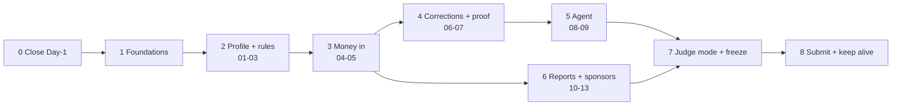

# Build flow

How Niryat goes from the scaffold to a submitted, judge-ready product, phase by phase. [PLAN](PLAN.md) owns scope and dates (§5 features, §17 timeline); if this document disagrees with PLAN, PLAN wins. Each phase lists its goal, the specs it covers, what to build and the exit gate that must pass before the next phase starts.

## Principles that apply to every phase

- **One spec per task.** Pick a spec in [docs/specs](specs/), read the nearest `AGENTS.md`, plan multi-file work, then build it.
- **Shared plumbing is built inside the first spec that needs it**, not as a separate project. Phase 1 names which spec gets each piece.
- **Golden rules hold throughout:** legal and numeric logic only in `packages/rules`; every PayPal action goes through the user-approval queue; sandbox only; zod at every boundary. See [AGENTS.md](../AGENTS.md).
- **Done means** `pnpm verify` passes, tests cover the change, and only satisfied spec checkboxes are ticked. Run `pnpm build` for web changes.
- **India limitations are recorded in the spec**, dropping only the affected sub-item, never the whole feature ([paypal.md](paypal.md)).

## Phase 0: Close the Day-1 checklist (Oct 24–25)

**Goal:** no feature starts on an unverified assumption.

**Status: complete (2026-10-25).** All PayPal rows have evidence or a recorded limitation. Sign-in is decided (email). `DATABASE_URL` from `.env` connects to the local Postgres. The rows marked "runs in parallel" stay open and gate only their own specs.

| Item                                                                                                     | State                                                                                                                                             | Action                                                                                                                                                                                                                                            |
| -------------------------------------------------------------------------------------------------------- | ------------------------------------------------------------------------------------------------------------------------------------------------- | ------------------------------------------------------------------------------------------------------------------------------------------------------------------------------------------------------------------------------------------------- |
| PayPal capabilities #1–8                                                                                 | Answered                                                                                                                                          | See [sandbox findings](paypal-sandbox-findings.md)                                                                                                                                                                                                |
| Log in with PayPal                                                                                       | **Works through an app the seller does not own**; signing in to the seller's own app returns `userinfo` HTTP 400 (root cause 2026-10-29)          | **Decided: email sign-in** (2026-10-25); the seller is connected via the app credentials ([spec 01](specs/01-health-check.md#india-sandbox-limitations), [verification V02](verification.md#v02-identity)). Optionally report the error to PayPal |
| Webhooks fire for payments, refunds, disputes                                                            | Refund event delivered; **no dispute event** for an `INQUIRY`-stage dispute, although subscribed (2026-10-25)                                     | Optionally send `CUSTOMER.DISPUTE.CREATED` from the Webhook Simulator. Spec 06 must also poll the Disputes API, so a missed event is caught                                                                                                       |
| Dispute opened from buyer, read via API                                                                  | **Done**: `PP-R-TBU-10194472` on `8T315006AD0597744`, read via Disputes API (2026-10-25)                                                          | [Findings](paypal-sandbox-findings.md#disputes-and-webhooks-2026-10-25)                                                                                                                                                                           |
| India limitations recorded in spec 04                                                                    | **Done** (2026-10-25)                                                                                                                             | [Spec 04](specs/04-export-invoicing.md#india-sandbox-limitations)                                                                                                                                                                                 |
| Local Postgres for development                                                                           | **Running** (2026-10-25): Docker `postgres:17`, container `niryat-pg`, volume `niryat-pg-data`, on `127.0.0.1:5433`. Login from the host verified | Something else answers on host port 5432 (logins never reached the container), so the container uses **5433**. `DATABASE_URL` in `.env` must use port 5433                                                                                        |
| Indian rules (RBI period, Income-tax Act 2025 sections, Rule 46 wording, credit notes, GSTR-1 6A format) | **Done** (2026-10-25): all 12 rules `source_checked`                                                                                              | [rules-sources](rules-sources.md); open items listed there                                                                                                                                                                                        |
| Own redacted FIRA sample                                                                                 | Open, runs in parallel                                                                                                                            | Needed before spec 07                                                                                                                                                                                                                             |
| Render paid Postgres                                                                                     | Open, runs in parallel                                                                                                                            | Needed before Phase 7                                                                                                                                                                                                                             |

**Exit gate:** every PayPal row in PLAN §21 has evidence or a recorded limitation, Log in with PayPal is verified or a fallback is decided, and a development database is reachable. The parallel rows do not gate Phase 1; each gates only the spec that needs it.

## Phase 1: Foundations (Oct 25–27, built inside the first spec that needs each piece)

**Goal:** the shared plumbing every feature relies on, built once and tested.

**Order:** build the spec 01 rows now (database, email sign-in and sessions, rules loader), proved by a profile API with no UI. Build the spec 04 and 05 rows in Phase 3, inside those specs. Prerequisite done 2026-10-25: `drizzle.config.ts` loads the root `.env` when present, and a separate `niryat_test` database exists for integration tests.

| Foundation                                                                              | Built with | Notes from the spike                                                                                                                                        |
| --------------------------------------------------------------------------------------- | ---------- | ----------------------------------------------------------------------------------------------------------------------------------------------------------- |
| Database: migrations, connection, encryption of GSTIN/PAN/addresses, per-user isolation | Spec 01    | **Done (2026-10-25)**: migrations, connection, encrypted GSTIN/PAN fragments and per-user isolation; client address encryption deferred to spec 04          |
| Session + email sign-in                                                                 | Spec 01    | **Done (2026-10-25)**: email/password sign-in and signed-cookie sessions (API only)                                                                         |
| Rules loader + per-rule unit tests                                                      | Spec 01    | **Done (2026-10-25)**: loader and metadata tests; rules stay inert until implemented                                                                        |
| REST client for Invoicing v2 / Disputes v1 in `packages/paypal/src/rest`                | Spec 04    | **Done (2026-10-27)**: sandbox OAuth cache, POST request IDs, validated responses and retries; Invoicing is implemented, Disputes operations remain spec 06 |
| Approval queue persistence and execution (`agent_actions`)                              | Spec 04    | **Done (2026-10-27)**: persistent proposals, owner-scoped atomic approval claim, rejection, execution and retry outcomes                                    |
| File storage with shareable links                                                       | Spec 04    | **Done (2026-10-27)**: external S3-compatible storage (local SeaweedFS in development), served via `/api/files/:token`; PDF link in `detail.note`           |
| Webhook receiver with signature verification                                            | Spec 05    | **Done (2026-10-27)**: verify via PayPal before writes; dedupe payments by capture ID                                                                       |
| Server SDK install (transaction search, refunds)                                        | Spec 05    | **Done (2026-10-27)**: SDK capture reads and transaction-search reconciliation; refund operations remain spec 06                                            |

**Exit gate:** each foundation has tests and is used by at least one passing spec checkbox.

## Phase 2: Profile and pure rules: specs 01–03 (Oct 26–28)

**Status: complete (2026-10-26).** The export check shows "blocked" with reasons; spec 04 enforces it on the invoice route.

**Goal:** the user signs in, completes a profile and sees a cited health score.
- [01 Health check](specs/01-health-check.md): sign-in, profile, health score with rule citations.
- [02 Purpose code](specs/02-purpose-code.md): curated table is the source of truth; AI only suggests.
- [03 Export eligibility](specs/03-export-eligibility.md): five export conditions. Its "recipient outside India" check also guards invoice sending, since PayPal blocks India-based recipients (HTTP 406).

**Exit gate:** a sandbox user signs in, saves a profile, sees red flags with rule IDs, and a failing export check blocks the export invoice path.

## Phase 3: Money in: specs 04–05 (Oct 28–30)

**Status: complete (2026-10-27).** P3-15 steps 3–8 are user-confirmed: PDF and blocked-export checks, approved one-time send, webhook payment recording, active recurring series and reconciliation with `alreadyRecorded: 1`, `recorded: 0`, `failed: 0`. Extraction is deferred to Phase 5; recurring-cycle numbering and adoption remain open in spec 04.

**Goal:** the core demo loop works: invoice sent from India, paid by the US buyer, payment recorded with fee and net.
- [04 Export invoicing](specs/04-export-invoicing.md): extraction with user confirmation, GST PDF, consecutive numbering per financial year, one-time invoices and recurring series (both confirmed working). Milestone/partial payments: **unavailable for India sellers**; document it and do not build it. Any alternative, such as one invoice per milestone, is a product decision for the spec.
- [05 Payment tracking](specs/05-payment-tracking.md): webhooks are the real-time source; transaction search is nightly reconciliation only, since it indexes with a delay. Store gross, fee and net from the capture's `seller_receivable_breakdown` (PayPal returns `net_amount`). Match the capture's `invoice_id` to the stored PayPal invoice ID (`INV2-…`), rather than the Niryat invoice number.

P3-15 exit evidence (2026-10-27):
- The user ran verification without `.env` (27 successful tasks, zero cached, exit code 0), and confirmed `/health` and `/purpose-codes` work without credentials.
- Database integration suites executed: DB 81/81 and API 136/136 passed in the user's close-out logs, with no skipped tests.
- Invoice create/send/activate POST call sites are confined to the approval handlers; rejection, repeated approval and cross-user access are tested. YAML names six implemented functions, including `invoiceNumberFor` and `prepareExportInvoice`; six other rules remain `TODO`.
- P3-15 ticks spec 03 criterion 2, three spec 04 criteria and all three spec 05 criteria, together with PLAN §5. The optional scratch-database webhook-miss run was skipped; automated reconciliation tests cover backfill.

**Exit gate:** end-to-end sandbox run: approved invoice → sent → buyer pays → webhook records the payment → nightly sync agrees.

## Phase 4: Corrections and proof: specs 06–07 (Oct 31–Nov 2)

**Goal:** refunds, disputes and FIRAs keep the compliance record true.
- [06 Refunds and disputes](specs/06-refunds-disputes.md): refund webhooks update the invoice, credit-note data and realised amount; dispute webhooks plus Disputes API create alerts. Refunds are PayPal actions and go through approval.
- [07 FIRA matching](specs/07-fira-matching.md): parse the real redacted FIRA; confidence scores; user confirms low-confidence matches.

**Exit gate:** a sandbox refund and dispute each change the ledger and appear as tasks; a real FIRA matches with at least one flagged line.

## Phase 5: The agent: specs 08–09 (Nov 1–4)

**Goal:** Claude proposes PayPal actions; the user approves; every call is logged.
- [08 Monthly close](specs/08-monthly-close.md): Claude Agent SDK + PayPal Agent Toolkit behind the Phase 1 approval queue; Render Workflows schedule plus a "Close this month" button. Install the AI SDK and Toolkit here, not earlier.
- [09 RBI deadlines](specs/09-rbi-deadlines.md): countdown per unpaid invoice from the versioned rule; reminder proposals at 60 and 30 days (reminders confirmed working).

**Exit gate:** a scheduled and a manual close each produce an approval list; nothing executes unapproved; every number traces to PayPal data or a rule.

## Phase 6: Reports and sponsor tools: specs 10–13 (Nov 1–7)

**Goal:** the figures a CA needs, plus the sponsor integrations. Start the AG Studio and Bryntum trials **on or after Nov 1** so they cover judging.
- [10 GSTR-1 export](specs/10-gstr1-export.md): Table 6A file in the verified format, net of refunds.
- [11 Compliance calendar](specs/11-compliance-calendar.md): Bryntum; events from rules, invoices and disputes.
- [12 Dashboard](specs/12-dashboard.md): AG Studio on the ledger; three reliable natural-language questions.
- [13 Advance tax](specs/13-advance-tax.md): rules only; dates feed the calendar.

Specs 10 and 13 only need the Phase 3 ledger, so they can start in parallel with Phase 5 if someone is free.

**Exit gate:** GSTR-1 totals reconcile with invoices and refunds; calendar and dashboard render from real sandbox data.

## Phase 7: Judge mode, hosting and freeze (Nov 5–8)

- Deploy on Render with paid Postgres; register `monthlyClose`; "Try as judge" with a seeded profile ([PLAN §15](PLAN.md#15-judge-mode)).
- AI budget cap and rate limits; sandbox-only credentials for judges.
- Disclaimer / limitations page in the web app, showing [PLAN §23](PLAN.md#23-disclaimer). It covers not tax advice, no CA review of the rules, one seller per deployment and sandbox only.
- Stretch features ([PLAN §6](PLAN.md#6-stretch-features-only-if-time-allows)) only if 01–13 are solid.

**Exit gate:** **feature freeze Nov 8**; the full demo script ([PLAN §16](PLAN.md#16-demo-script-3-minutes)) runs on the hosted demo.

## Phase 8: Submit and keep alive (Nov 8 to Dec 15)

- Nov 8–10: testing, README, Devpost text, video under 3 minutes; tick the [compliance checklist](PLAN.md#19-hackathon-compliance-checklist).
- **Nov 11: submit**, one day before the deadline.
- Until Dec 15: keep the hosted demo, sandbox accounts, trial licences and AI budget alive.

## Known PayPal facts to build around

From the [sandbox findings](paypal-sandbox-findings.md), India seller to US buyer:

| Fact                                                   | Consequence                                                     |
| ------------------------------------------------------ | --------------------------------------------------------------- |
| One-time invoices, recurring series and reminders work | Build as planned in specs 04 and 09                             |
| Partial payments unavailable for India sellers         | Spec 04 documents milestone invoices as unavailable             |
| India-based recipients are blocked on send             | Export check (spec 03) validates the recipient's country first  |
| No attachment upload; references are unvalidated       | Host the PDF and link it in `detail.note`                       |
| Transaction search lags payments by hours              | Webhooks real-time, search for reconciliation                   |
| Capture returns gross, `paypal_fee`, `net_amount`      | Store PayPal's figures; do not compute net                      |
| App features gate scopes; tokens are reused ~9 h       | Document app setup; the REST client caches and refreshes tokens |
